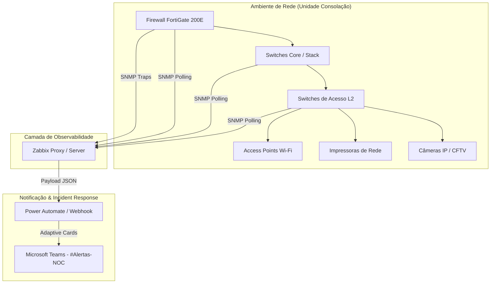

# 🛡️ Zabbix 7.0 & FortiGate: Observabilidade de Redes & Automação de Alertas no Microsoft Teams


Projeto prático de observabilidade e monitoramento contínuo para infraestrutura crítica de rede empresarial (Firewalls FortiGate, Switches L2/L3 Core e Acesso, Access Points e Impressoras), integrado com sistema de alertas em tempo real no Microsoft Teams via Webhook e Power Automate.

---

## 📐 Arquitetura da Solução



---

## 🚀 Funcionalidades Implementadas

### 1. FortiGate Configuration & Security Monitoring

* **SNMP Trap Monitoring:** Mapeamento do OID de alteração de regras e políticas do FortiGate.
* **Detecção de Mudanças Não Autorizadas:** Qualquer alteração em regras de firewall dispara um incidente de severidade **Desastre (Crítico)**, garantindo visibilidade imediata contra mitigações não auditadas.
* **Métricas de Performance:** Monitoramento de CPU, memória, estado de sessões e interfaces de VPN/Tunneling.

### 2. Switch Port Mapping & Infrastructure Health

* **Mapeamento L2/L3:** Monitoramento detalhado de switches de Core, Distribuição e Acesso (Stack e Standalone).
* **Gestão de Severidade Dinâmica:**
* **Critical / Disaster:** Portas de Uplink, Access Points (Wi-Fi), Impressoras corporativas e Câmeras CFTV configuradas para notificação em tempo real ao cair o link (`Link Down`).
* **Warning / Info:** Métricas secundárias como variações de Duplex, alteração de velocidade negociada e utilização de banda acumuladas no painel do Zabbix para evitar poluição no Teams (*Alert Fatigue*).


### 3. Integrador Webhook & Teams Incident Response

* Integração via **Webhook HTTP** enviando payloads padronizados em JSON.
* Formatação de **Adaptive Cards** em vermelho para incidentes críticos no canal `#Alertas-NOC`.
* Resolução automática no Teams assim que o status do link/equipamento retorna ao estado `OK`.

---

## ⚙️ Configurações no Zabbix & Automações

### Expressão de Trigger para Alteração de Política (FortiGate)

```ini
{FW-CONSOLACAO-200E-M:snmptrap["fortinet.fnSysEventTrap"].nodata(5m)}=0

```

### Expressão de Trigger para Status de Interface (Link Down)

```ini
{$IFCONTROL:"Gi1/0/5"}=1 and last(/SW-ACESSO-117/net.if.status[ifOperStatus.5])=2 and (last(/SW-ACESSO-117/net.if.status[ifOperStatus.5],#1)<>last(/SW-ACESSO-117/net.if.status[ifOperStatus.5],#2))

```

### Payload JSON para Webhook (MS Teams / Power Automate)

```json
{
  "event_id": "{EVENT.ID}",
  "severity": "{EVENT.SEVERITY}",
  "host": "{HOST.NAME}",
  "ip": "{HOST.IP}",
  "item": "{ITEM.NAME}",
  "status": "{EVENT.VALUE}",
  "time": "{EVENT.TIME}",
  "date": "{EVENT.DATE}",
  "message": "{ALERT.MESSAGE}"
}

```

---

## 🛠️ Tecnologias Utilizadas

* **Monitoramento:** Zabbix 7.0 LTS
* **Ativos de Rede:** Fortinet FortiGate 200E, Switches Cisco/HPE/Aruba
* **Protocolos:** SNMP v2c/v3, SNMP Traps, ICMP
* **Automação & Alerta:** Microsoft Power Automate, Webhooks, Adaptive Cards JSON, Microsoft Teams

---

## 📊 Impacto na Operação (NOC / SOC)

* **MTTD (Mean Time to Detect):** Reduzido para **< 1 minuto** para quedas em APs, impressoras críticas e uplinks.
* **Auditoria de Segurança:** Alertas imediatos para a equipe de redes/segurança em caso de qualquer alteração de política no firewall.
* **Redução de Ruído:** Filtragem de alertas no canal de chat, garantindo que o NOC atue apenas em incidentes genuinamente críticos.
